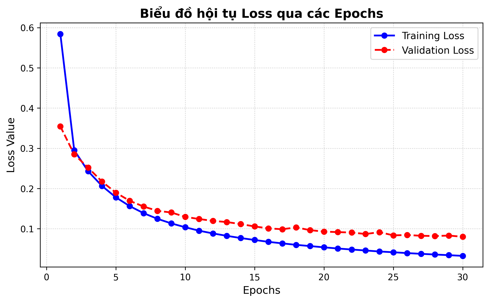

# A MNIST Handwritten classifier using Pytorch

This project develops MLP neural network for classifying handwritten digits from MNIST data set using Pytorch as a framework

## Project Structure

pytorch_mnist/
- data.py            # Download and split the dataset; create DataLoaders
- model.py           # Define the MLP architecture
- engine.py          # Implement training and evaluation functions
- train_model.py     # Run training and save the best checkpoint
- requirements.txt   # List project dependencies
- README.md          # Project documentation
- data/              # Downloaded dataset (not tracked by Git)
- checkpoints/       # Saved model checkpoints (not tracked by Git)

## Model Architechture

The classifier uses the following MLP architecture:

Input image (28 × 28)

        ↓

      Flatten

        ↓

  Linear (784 → 256)

        ↓
       ReLU

        ↓
  Linear (256 → 10)

        ↓

    10 logits

## Dataset

Download from MNIST dataset from torchvision

----------------------
## Result and Performance

- The model was trained for 30 epochs

|Metric                  |Result    |
| ---------------------- | ------- |
|Best validation accuracy|97.42%   |
|Test accuracy           |97.89%   |

- At first 30 epochs, model shows optimal fit with training loss and validation loss gradually decline, eventually converge at a low level(approx 0.05 and 0.1). The train loss curve under the validation loss at a acceptable generation gap.
 
## How to run

**1. Clone repository**

        - !git clone https://github.com/Horizon-1-a/Machine-learning-process.git

        - %cd Machine-learning-process/pytorch_learning/pytorch_mnist

**2. Install dependencies**

        - python -m pip install -r requirements.txt

**3. Train the model**

        - !python train_model.py

## Requirements:
- python 3.11.x
- pytorch
- torchvision
- numpy
- matplotlib

